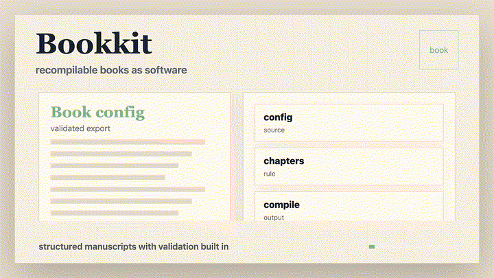

# Bookkit — Recompilable Books (Astro + Bun)

<p align="center">
  
</p>

Bookkit is a **book compiler**, not a CMS and not an editor. A book is a specification with hard structure; the engine validates it, frames it, and renders it into verified artifacts. Content cannot drift into abstraction — the compiler stops it.

> **AI may propose; the compiler decides.**

## Start here

A worked example is the **On-Call Runbook** (`apps/on-call/`): a recompilable operating procedure that compiles into a web book *and* an audit surface. Each control maps to a mechanism, each mechanism to a 10-minute tool, each tool to a drill and an escalation ramp — and `bun run check:runbooks` derives the compliance matrix from that.

```txt
$ bun run check:runbooks
RUNBOOK CHECKS (5) [on-call]
- [runbook-coverage/info] (book): All toolkit releases keep every declared control drilled at HEAD.
    → No action needed; compliance evidence is current.
- [runbook-coverage/warning] toolkit/incident-triage--classify-alert-severity.mdx: Tool "classify-alert-severity" declares a 30-day review cadence, but no release has been recorded since 2026-02-10; review was due 2026-03-12 (186 days overdue).
    → Review the procedure, record the outcome in a release note or drill, or update reviewEveryDays to match the real cadence.
- [runbook-coverage/warning] toolkit/bounded-escalation--ramp-escalation.mdx: Tool "ramp-escalation" declares a 30-day review cadence, but no release has been recorded since 2026-02-10; review was due 2026-03-12 (186 days overdue).
    → Review the procedure, record the outcome in a release note or drill, or update reviewEveryDays to match the real cadence.
- [runbook-coverage/warning] toolkit/minimal-repro-doc--capture-repro.mdx: Tool "capture-repro" declares a 30-day review cadence, but no release has been recorded since 2026-02-10; review was due 2026-03-12 (186 days overdue).
    → Review the procedure, record the outcome in a release note or drill, or update reviewEveryDays to match the real cadence.
- [runbook-coverage/warning] toolkit/rollback-first-change--identify-rollback-candidate.mdx: Tool "identify-rollback-candidate" declares a 14-day review cadence, but no release has been recorded since 2026-02-10; review was due 2026-02-24 (202 days overdue).
    → Review the procedure, record the outcome in a release note or drill, or update reviewEveryDays to match the real cadence.
COMPLIANCE on-call: 4/4 controls with tool coverage
  DIAG-REPRO-01 → minimal-repro-doc [capture-repro] ✓drilled ⚠review overdue (due 2026-03-12)
  ESC-RAMP-01 → bounded-escalation [ramp-escalation] ✓drilled ⚠review overdue (due 2026-03-12)
  INC-TRIAGE-01 → incident-triage [classify-alert-severity] ✓drilled ⚠review overdue (due 2026-03-12)
  REL-ROLLBACK-01 → rollback-first-change [identify-rollback-candidate] ✓drilled ⚠review overdue (due 2026-02-24)
```

## How a book compiles

1. **The author decides intent** in `apps/<book>/src/book.config.ts`: goals, constraints, a frame (intervention, field-guide, or runbook).
2. **Content binds to structure** in `apps/<book>/src/content/book/`: chapters, mechanisms, toolkit primitives, examples, glossary.
3. **The compiler gates every change**: schema validation → frame checks (required headings are structurally detectable, not just written) → ordering constraints → separation-of-concerns.
4. **AI proposes, gates decide**: deterministic analyzers suggest mechanisms, prerequisite edges, example swaps, and runbook coverage — but nothing AI-generated bypasses a validator.
5. **Verified artifacts compile out**: read UI, PDF/EPUB exports, an MCP endpoint, and (for runbook books) a coverage/compliance matrix.

## What's here

- **4 books on one engine**: three nonfiction books (`bad-people`, `running-hot`, `crumple-zone`) and the `on-call` runbook. `bun run list:books` is the source of truth.
- **No silent drift**: schemas, frames, and shims are enforced by gates (`validate`, `check:shims`, `check:separation`), and `check:corpus` keeps a mechanism meaning one thing across books.

---

## TL;DR (for developers and agents)

- **Engine logic** lives in `packages/astro-bookkit/**`.
- **Book decisions** live in `apps/<book>/src/book.config.ts`.
- **Book content bindings** live in `apps/<book>/src/content/book/**`.
- Do not put book-specific behavior in content files.
- Run `bun run validate` before opening a PR.

For how the whole system fits together, see [`docs/architecture.md`](./docs/architecture.md). For contribution lanes and workflow, see [`CONTRIBUTING.md`](./CONTRIBUTING.md). For non-negotiable architectural rules, see [`AGENTS.md`](./AGENTS.md). For the reasoning behind the invariants, see [`docs/design-notes.md`](./docs/design-notes.md).

---

## Documentation map

| Document | Canonical for | Audience |
| --- | --- | --- |
| [`README.md`](./README.md) | Orientation + operational commands | Developers + maintainers |
| [`docs/architecture.md`](./docs/architecture.md) | System structure: layers, pipelines, module map, import rules | Developers + agents |
| [`AGENTS.md`](./AGENTS.md) | Architectural invariants + risk boundaries | Agents + reviewers |
| [`CONTRIBUTING.md`](./CONTRIBUTING.md) | Contribution workflow + lanes | Human + AI contributors |
| [`docs/design-notes.md`](./docs/design-notes.md) | Why the invariants exist + error philosophy | Reviewers + new contributors |
| [`docs/authorship-model.md`](./docs/authorship-model.md) | "Book as Software" philosophy + three-pillar model | Authors + strategists |
| [`docs/bets.md`](./docs/bets.md) | What gets worked on next and why: anchor, active bets, parked work | Maintainers + agents |
| [`docs/commercial-roadmap.md`](./docs/commercial-roadmap.md) | Productization scope (sequencing lives in `docs/bets.md`) | Maintainers + operators |
| [`docs/tech-debt-register.md`](./docs/tech-debt-register.md) | The queue of cross-cutting debt | Maintainers |
| [`CHANGELOG.md`](./CHANGELOG.md) | Dated behavior changes and migration notes | Everyone |
| [`.codex/skills/`](./.codex/skills/README.md) | Lane checklists for agents (content, engine, release, reader typography) | Agents |
| [`packages/astro-bookkit/README.md`](./packages/astro-bookkit/README.md), `apps/<book>/README.md` | Package- and book-local orientation | Engine and book contributors |

Prefer linking to canonical docs over duplicating policy text.

---

## Direction

What gets built next is decided in [`docs/bets.md`](./docs/bets.md); the active bet is B1, keeping one author's books one argument with stable, non-overlapping mechanisms. Productization scope (hosted compile, MCP workflows, governance APIs) is in [`docs/commercial-roadmap.md`](./docs/commercial-roadmap.md).

---

## Workspace architecture

Bookkit treats a book as an **executable specification**, not a static document; the philosophy is in [`docs/authorship-model.md`](./docs/authorship-model.md). The three layers (author decisions, engine, content bindings) are summarized in the TL;DR above and enforced by [`AGENTS.md`](./AGENTS.md).

```txt
.
├─ apps/       # one directory per book: config, content, routes, thin runtime wiring
├─ packages/   # astro-bookkit (the engine) + create-bookkit (project generator)
├─ scripts/    # CLI entrypoints: governance gates, scaffolds, compile/export tasks
└─ docs/       # architecture, bets, design notes, roadmap, debt register
```

**[`docs/architecture.md`](./docs/architecture.md) is canonical for the rest**: the engine module map, the tier rules that govern which module may import which, the two pipelines (Astro render vs. Bun governance CLI), the content-section contract, and the extension points for adding a frame, a schema field, a gate, or an agent tool.

That document is verified rather than trusted — `bun run check:architecture` fails CI if it stops matching the tree, so the module map, layering, and import cycles it describes are the real ones. Book apps stay thin for one reason worth knowing up front: Vite resolves `import.meta.glob()` relative to the calling file and Astro discovers routes by filename, so `src/lib/book-runtime.ts` and `src/pages/**` must be app-local. Everything else is a re-export held identical across books by `bun run check:shims`.

---

## Prerequisites

- **Bun 1.3+** (workspace package manager + task runner)
- **Node.js 22+** for Astro 7 compatibility

Install dependencies:

```bash
bun install
```

### Codex setup (recommended)

To bootstrap local Codex usage for this repo (dependency install + skill linking + baseline checks):

```bash
bun run setup:codex
```

For faster iteration (skip install/checks), run:

```bash
bash scripts/codex-setup.sh --skip-install --skip-checks
```

---

## Daily commands

### Run a book app

```bash
bun run bookkit dev bad-people
bun run bookkit dev running-hot
```

### Lint / format / types

```bash
bun run lint
bun run format
bun run check:types
```

### Tests

```bash
bun run test
```

### Validation

```bash
bun run validate
bun run validate:release
```

### Full upgrade safety net

```bash
bun run check:upgrade
bun run check:upgrade -- --release
```

### Build / compile / export

```bash
bun run bookkit build bad-people
bun run compile:book -- --book bad-people
bun run export:gitbook -- --book bad-people
```

### Deploy

Every book builds to a static site and ships to [Cloudflare Workers static assets](https://developers.cloudflare.com/workers/static-assets/). Each app carries a `wrangler.jsonc` (Worker name `bookkit-<slug>`, `dist/` as the asset directory, `404.html` for misses, and URLs served without trailing slashes so they match the canonical links in the sitemap).

```bash
bun run qa                                   # lint, types, tests, validate, build, verify dist/
bun run bookkit deploy on-call --dry-run     # build + verify + wrangler dry run
bun run bookkit deploy on-call               # publish one book
bun run deploy                               # publish every book
```

`deploy` refuses to publish a book whose `dist/` fails `bun run check:build` (see below). Before the first real deploy: run `wrangler login` once, then set `site.url` in `apps/<book>/src/book.config.ts` to the real domain and attach that domain to the Worker in the Cloudflare dashboard. The `*.workers.dev` address works immediately and is marked `noindex` by `public/_headers`.

What a static deployment serves, and what it cannot:

- **Served**: the read UI, search, PDF/EPUB exports, sitemap, robots.txt, RSS, OG images, the MCP discovery manifest (`GET /api/mcp.json`), and the `_headers` security and caching rules.
- **Inert**: everything that needs a request handler. Feedback and analytics collection, AI Q&A synthesis (the panel falls back to on-device answers), release webhooks and email, and MCP JSON-RPC calls (`POST /api/mcp.json`) all need on-demand rendering plus durable storage, which the current file-backed handlers do not have. The client code degrades silently.
- **Not enforceable**: `previewAccess`. Astro runs middleware while prerendering, so a token gate cannot protect static files; the engine skips it for prerendered routes and warns during the build. Protect drafts at the edge (for example Cloudflare Access) instead.

`bun run check:build` verifies each `dist/`: no page rendered as a preview lockout, real PDF and EPUB bytes, the 404 page and SEO artifacts present, one site URL across canonical links, robots.txt, and the sitemap, and no `noindex` on a book whose status is `published`. CI runs it after every build.

### Helpful utilities

```bash
bun run list:books
bun run check:separation
bun run check:architecture
bun run check:concepts
bun run check:suggestions
bun run check:corpus
bun run check:runbooks
bun run check:runbooks -- --mode error
bun run check:todos
bun run check:shims
bun run stack:capabilities
```

`bun run check:suggestions [--book <slug>]` is the AI assistance layer: it analyzes a book and reports actionable, deterministic suggestions — overlapping mechanisms, unregistered recurring concepts (with candidate mechanism drafts), examples that restate a mechanism instead of illustrating it, and missing prerequisite edges for the reading graph. It never writes files; it proposes and you approve.

`bun run check:corpus [--books a,b,c]` runs the overlap check across books, so one author's books can't name the same idea twice without anyone noticing. A lexical pass compares wording; a semantic pass compares meaning with a small local embedding model (`Xenova/all-MiniLM-L6-v2` via the optional `@xenova/transformers` dependency; the first run downloads about 25 MB, cached in `BOOKKIT_MODEL_CACHE` when set). Overlapping pairs are grouped into clusters, each one a candidate for "one mechanism" or "distinct, sharpen the boundaries". A slug names one mechanism across the corpus: books that share a mechanism carry copies under the same slug, and the check reports drift if the copies' contracts differ. `corpus.json` at the repo root names the default books and records pairs the author has ruled distinct, each with a reason. Pass `--no-semantic` to skip the model, `--threshold <n>` to change the semantic cutoff (default 0.45), `--json` or `--export <file>` for machine output, and `--mode error` to exit 1 while any cluster, drift, or stale ruling remains. Like `check:suggestions`, it never writes content.

`bun run bookkit propose <book>` is the materialization layer: it turns the suggestion set into a reviewable **proposal bundle** — an end-to-end trace from raw source to compiled structure. Give it a book that is imported-but-unstructured (or any book mid-edit) and it returns: a frame proposal (runbook vs intervention, from keyword signals), drafts for every unregistered recurring mechanism, prerequisite edges the reading graph is missing, toolkit bindings for uncovered mechanisms, and a `book.config.ts` draft for a book that has none.

```bash
bun run bookkit propose <book>                 # review the bundle
bun run bookkit propose <book> --write          # write bundle artifacts to apps/<book>/proposals/
bun run bookkit propose <book> --apply mechanisms --apply tools --apply config
```

`--apply` materializes approved proposals into the content tree (`mechanisms/`, `toolkit/`, and a config draft under `proposals/`), refusing to overwrite or redefine anything already registered. Frame choice, mechanism identity, and config stay author decisions — the tool proposes and writes draft structure, never a live `book.config.ts`. Pass `--detect-frame` to see what the content implies even when a frame is already declared, and `--id <proposal>` to accept a specific proposal.

`bun run check:runbooks [--book <slug>]` is the runbook verification layer: for runbook-frame books it audits control coverage (mechanism → tool → drill → escalation → owner), derives the compliance matrix, and joins release narratives against HEAD coverage to flag drift. Pass `--mode error` to fail on any open coverage item.

### MCP endpoint for agentic clients

Book apps expose an MCP endpoint (for example `apps/bad-people/src/pages/api/mcp.json.ts`) so agentic LLM clients can:

- list/read content and governance resources
- discover lane skills under `.opencode/skills/**`
- call deterministic workspace tools (`bookkit.list_books`, `bookkit.read_book`, `bookkit.list_skills`, `bookkit.validate_book`, etc.)
- scaffold a new book via guarded mutation tooling (`bookkit.create_book`) when explicit creation is required

Use this as the default machine interface instead of ad-hoc repository scraping. On a static deployment only the `GET` manifest is served; tool calls need an on-demand runtime (run `bun run bookkit dev <book>` locally).

### CI

GitHub Actions runs on every push and PR to `main`:

- `bun run lint` — Biome style check
- `bun run check:types` — TypeScript across all apps + package
- `bun run check:separation` — content boundary enforcement
- `bun run check:architecture` — architecture doc matches the tree (module map, tiers, cycles)
- `bun run check:todos` — TODO policy check
- `bun run check:shims` — shim consistency
- `bun run validate` — schema + frame validation for all books
- `bun run test` — Bun test runner across all suites
- `bun run build:all` — static build of every book
- `bun run check:build` — deployability check on every `dist/`


### Task-driven command recipes

| If you need to… | Run | Why |
| --- | --- | --- |
| iterate on one book UI quickly | `bun run bookkit dev bad-people` | Fast local feedback loop for content + layout work |
| verify architecture invariants before review | `bun run validate && bun run check:separation && bun run check:architecture` | Catches frame/content boundary regressions and architecture-doc drift |
| sanity-check concept registry hygiene | `bun run check:concepts` | Prevents floating named concepts |
| find mechanisms that name the same idea in different books | `bun run check:corpus -- --books <a>,<b>` | Semantic and lexical overlap across a body of work |
| get AI-style editing suggestions | `bun run check:suggestions -- --book bad-people` | Flags overlaps, example restatement, and missing graph edges |
| turn raw markdown into structured content | `bun run bookkit import --book <slug> --dir ./notes && bun run bookkit propose <slug> --apply mechanisms --apply tools` | Imports prose, then materializes mechanism/tool drafts from recurring concepts |
| test release readiness | `bun run validate:release && bun run check:upgrade -- --release` | Exercises strict validation path |
| rebuild end-user artifacts | `bun run bookkit build bad-people && bun run export:gitbook -- --book bad-people` | Ensures compile + export surfaces stay healthy |
| run all quality gates | `bun run qa` | Full CI-equivalent local check, including the build and `dist/` verification |

---

## Troubleshooting and diagnostics

### Build succeeds but every page is a "preview required" lockout

- `previewAccess.enabled` was true while every token was expired or revoked, and Astro rendered the middleware's 401 page into `dist/`. The engine now bypasses the gate for prerendered routes, and `bun run check:build` fails on any lockout page, so this cannot ship silently.
- Disable `previewAccess` for published books; static output cannot honor tokens anyway.

### Validation fails but content "looks right"

- Re-check required frame sections (headings/fields must be structurally present, not implied in prose).
- Run `bun run validate:release` to see stricter failure output.
- Fix the failing record rather than relaxing validator strictness.

### Build passes but outputs feel semantically off

- Run `bun run check:concepts` and review glossary/mechanism drift.
- Confirm example edits did not mutate mechanism definitions.
- Re-run `bun run compile:book -- --book bad-people --mode error --no-drafts` to catch hidden assumptions.
- Run `bun run check:corpus` to catch a mechanism that restates one in another book.

---

## Migration notes

Breaking changes and their migrations are recorded in [`CHANGELOG.md`](./CHANGELOG.md), newest first.

---

## Create a new book

Use the scaffold command (defaults to template `bad-people`):

```bash
bun run new:book -- --book <new-book> --title "Your Book Title"
```

Then:

1. Update `apps/<new-book>/src/book.config.ts`.
2. Replace starter content under `src/content/book/**`.
3. Run `bun run validate` and `bun run validate:release`.
4. Run `bun run bookkit dev <new-book>` to iterate locally.

Do not fork the engine to customize one book.

### Import from existing markdown

To pull prose in from a folder of existing `.md`/`.mdx` files (chapter layer only):

```bash
bun run bookkit import --book <new-book> --dir /path/to/markdown
```

Import writes chapters and never touches mechanisms, toolkit, or glossary — those stay author-gated so the compiler's separation invariants hold. Follow the printed next steps: register recurring patterns as mechanisms, bind tools, then run `check:suggestions` to let the analyzer propose drafts of both.

To remove a scaffolded book app:

```bash
bun run remove:book -- --book <book-slug>
```

### Scaffold a standalone project

To generate a self-contained book project (app + vendored engine + checker scripts) in a new directory:

```bash
bun run create-bookkit <dir> --book <slug> --title "Book Title" [--dir /path/to/markdown]
```

The generated project works without publishing anything: `packages/astro-bookkit/` is vendored into it. Try it:

```bash
cd <dir> && bun install
bun run validate
bun run dev
```

Switch from `intervention` to `runbook` in `src/book.config.ts` to add drill-owned actions, and `bun run runbooks` produces the compliance matrix.

---

## License

This project is dedicated to the public domain under [CC0 1.0 Universal](./LICENSE).
