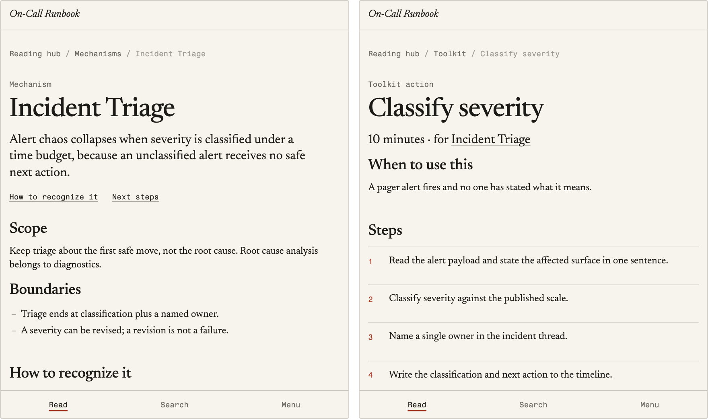
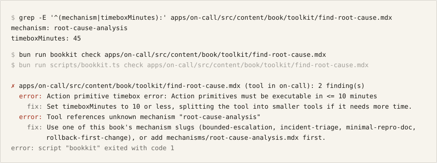
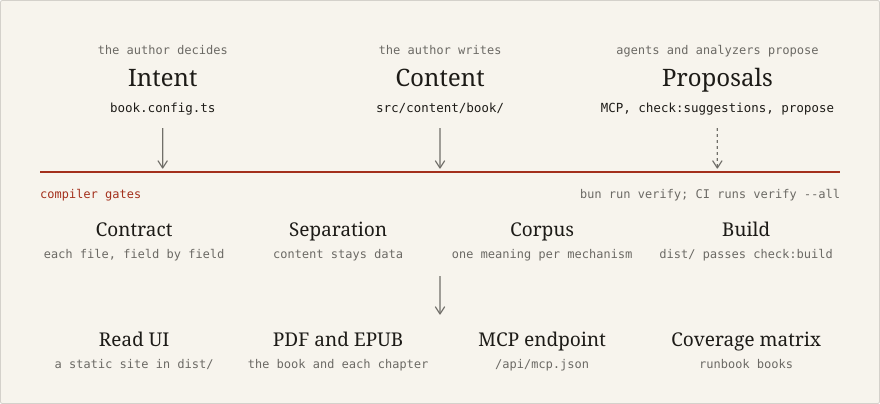

# Bookkit — Recompilable Books (Astro + Bun)

<p align="center">
  <a href="https://github.com/zz-plant/bookkit/actions/workflows/ci.yml"></a>
  <a href="./LICENSE"></a>
  <a href="https://bun.sh"></a>
</p>

<picture>
  <source media="(prefers-color-scheme: dark)" srcset="docs/assets/on-call-pages-dark.png">
  
</picture>

<sub>Two pages of the On-Call Runbook as Bookkit builds it: the Incident Triage mechanism, and the 10-minute tool that applies it.</sub>

Bookkit is a **book compiler**, not a CMS and not an editor. A book is a specification with hard structure; the engine validates it, frames it, and renders it into verified artifacts. Content cannot drift into abstraction — the compiler stops it.

> **AI may propose; the compiler decides.**

<picture>
  <source media="(prefers-color-scheme: dark)" srcset="docs/assets/bookkit-check-dark.svg">
  
</picture>

<sub>Real output of `bun run bookkit check` on a toolkit action broken on purpose: a 45-minute timebox, and a mechanism the On-Call Runbook doesn't define. `bun run verify`, which CI runs, fails on the same two errors.</sub>

## Start here

Writing goes through one command, `bun run bookkit`. After `bun install`:

```sh
bun run bookkit                          # where each book stands, and the next thing to write
bun run bookkit use running-hot          # pick your book once; commands default to it
bun run bookkit new chapter "Repair has a clock"
bun run bookkit dev                      # preview in the browser, live reload
bun run bookkit check <file.mdx>         # what a file still needs, field by field, with fixes
bun run bookkit try <folder>             # what your existing docs would become; writes nothing
bun run verify                           # the checks your change needs, before you commit
```

You don't have to memorize arguments. `bun run bookkit new` asks what to start (chapter, mechanism, tool, example) and anything else it needs, offering the book's mechanisms to pick from. A mistyped command, book, or mechanism gets the closest match suggested. `bun run bookkit help` lists every command.

### Already have documents? See what they would become

`bun run bookkit try <folder>` reads any folder of Markdown (a wiki export, a runbook repo, a blog archive) and writes nothing. It shows the shape Bookkit would hold the folder to and how much of it each document already has, the named ideas that recur across documents, and the commands that turn the folder into a book. Real output on three runbooks exported from a team wiki, trimmed to the analysis:

```txt
$ bun run bookkit try runbooks
  3 files, 150 words: 3 prose documents

Shape: Runbook (detected from the wording, 100% of the signals)
  Every document needs a section for each step: a heading or a "Label:" line whose words start like the step.
    ✓ Ownership     2 of 3
    ✓ Trigger       1 of 3
    ✓ Steps         2 of 3
    ✓ Escalation    2 of 3
    ✓ Verification  1 of 3
  2 of 3 would fail a runbook check today.

Ideas that recur (named across documents; register each once, then every document binds to it)
  Incident Commander  3 times in 3 documents
  Ledger Service      3 times in 2 documents
  Refund Worker       2 times in 2 documents

1 document uses {braces}, <tags>, HTML comments, or <autolinks>; import converts them so they compile as MDX.
```

The same analysis is a gate. `bun run bookkit check <folder> --frame runbook` exits 1 when a document is missing a section or a contract file breaks its contract, so a folder can be checked in CI where it lives, without converting it first. `--json` hands the whole result to a pipeline or an agent. To make the folder a book, `bun run bookkit new book <slug> --from <folder>` (it imports the folder into the new book), then `bun run bookkit propose <slug>`.

### Example: the On-Call Runbook

`apps/on-call/` compiles one operating procedure into a web book *and* an audit surface. Each control maps to a mechanism, each mechanism to a 10-minute tool, and each tool to a drill and an escalation ramp. `bun run check:runbooks` derives the compliance matrix:

```txt
$ bun run check:runbooks
COMPLIANCE on-call: 4/4 controls with tool coverage
  DIAG-REPRO-01 → minimal-repro-doc [capture-repro] ✓drilled ⚠review overdue (due 2026-03-12)
  ESC-RAMP-01 → bounded-escalation [ramp-escalation] ✓drilled ⚠review overdue (due 2026-03-12)
  INC-TRIAGE-01 → incident-triage [classify-alert-severity] ✓drilled ⚠review overdue (due 2026-03-12)
  REL-ROLLBACK-01 → rollback-first-change [identify-rollback-candidate] ✓drilled ⚠review overdue (due 2026-02-24)
```

(The reviews read as overdue because the book's release dates are fixtures.)

## How a book compiles

<picture>
  <source media="(prefers-color-scheme: dark)" srcset="docs/assets/how-a-book-compiles-dark.svg">
  
</picture>

1. **The author decides intent** in `apps/<book>/src/book.config.ts`: goals, constraints, a frame (intervention, explainer, field-guide, or runbook).
2. **Content binds to structure** in `apps/<book>/src/content/book/`: chapters, mechanisms, toolkit primitives, examples, glossary.
3. **The compiler gates every change**: each file against its section's contract (required fields, tools of 10 minutes or less, mechanisms the book defines), separation of concerns, one meaning per mechanism across books, and a build whose `dist/` passes `check:build`. `bun run verify` runs these gates and CI runs `verify --all`. A framing chapter that lacks a step its frame requires gets a warning.
4. **AI proposes, gates decide**: deterministic analyzers suggest mechanisms, prerequisite edges, example swaps, and runbook coverage — but nothing AI-generated bypasses a validator.
5. **Verified artifacts compile out**: read UI, PDF/EPUB exports, an MCP endpoint, and (for runbook books) a coverage/compliance matrix.

## What's here

- **4 books on one engine**: three nonfiction books (`bad-people`, `running-hot`, `crumple-zone`) and the `on-call` runbook. `bun run list:books` is the source of truth.
- **No silent drift**: schemas, frames, and shims are enforced by gates (`validate`, `check:shims`, `check:separation`), and `check:corpus` keeps a mechanism meaning one thing across books.

---

## TL;DR (for developers and agents)

- **Engine logic** lives in `packages/astro-bookkit/**`.
- **Book decisions** live in `apps/<book>/src/book.config.ts`.
- **Book content bindings** live in `apps/<book>/src/content/book/**`.
- Do not put book-specific behavior in content files.
- Run `bun run verify` before opening a PR: it runs the checks your change needs, and CI runs `verify --all`.

For how the whole system fits together, see [`docs/architecture.md`](./docs/architecture.md). For contribution lanes and workflow, see [`CONTRIBUTING.md`](./CONTRIBUTING.md). For non-negotiable architectural rules, see [`AGENTS.md`](./AGENTS.md). For the reasoning behind the invariants, see [`docs/design-notes.md`](./docs/design-notes.md).

---

## Documentation map

| Document | Canonical for | Audience |
| --- | --- | --- |
| [`README.md`](./README.md) | Orientation + operational commands | Developers + maintainers |
| [`docs/architecture.md`](./docs/architecture.md) | System structure: layers, pipelines, module map, import rules | Developers + agents |
| [`AGENTS.md`](./AGENTS.md) | Architectural invariants + risk boundaries | Agents + reviewers |
| [`CONTRIBUTING.md`](./CONTRIBUTING.md) | Contribution workflow + lanes | Human + AI contributors |
| [`docs/design-notes.md`](./docs/design-notes.md) | Why the invariants exist + error philosophy | Reviewers + new contributors |
| [`docs/authorship-model.md`](./docs/authorship-model.md) | "Book as Software" philosophy + three-pillar model | Authors + contributors |
| [`docs/bets.md`](./docs/bets.md) | What gets worked on next and why: anchor, active bets, parked work | Maintainers + agents |
| [`docs/tech-debt-register.md`](./docs/tech-debt-register.md) | The queue of cross-cutting debt | Maintainers |
| [`CHANGELOG.md`](./CHANGELOG.md) | Dated behavior changes and migration notes | Everyone |
| [`.codex/skills/`](./.codex/skills/README.md) | Lane checklists for agents (content, engine, release, reader typography) | Agents |
| [`packages/astro-bookkit/README.md`](./packages/astro-bookkit/README.md), `apps/<book>/README.md` | Package- and book-local orientation | Engine and book contributors |

Prefer linking to canonical docs over duplicating policy text.

---

## Direction

What gets built next is decided in [`docs/bets.md`](./docs/bets.md); the active bet is B1, keeping one author's books one argument with stable, non-overlapping mechanisms. Work that waits until a bet needs it, such as MCP and governance-API hardening and reader forking, is listed there too.

---

## Workspace architecture

Bookkit treats a book as an **executable specification**, not a static document; the philosophy is in [`docs/authorship-model.md`](./docs/authorship-model.md). The three layers (author decisions, engine, content bindings) are summarized in the TL;DR above and enforced by [`AGENTS.md`](./AGENTS.md).

```txt
.
├─ apps/       # one directory per book: config, content, routes, thin runtime wiring
├─ packages/   # astro-bookkit (the engine) + create-bookkit (project generator)
├─ scripts/    # CLI entrypoints: governance gates, scaffolds, compile/export tasks
└─ docs/       # architecture, bets, design notes, authorship model, debt register
```

**[`docs/architecture.md`](./docs/architecture.md) is canonical for the rest**: the engine module map, the tier rules that govern which module may import which, the two pipelines (Astro render vs. Bun governance CLI), the content-section contract, and the extension points for adding a frame, a schema field, a gate, or an agent tool.

That document is verified rather than trusted — `bun run check:architecture` fails CI if it stops matching the tree, so the module map, layering, and import cycles it describes are the real ones. Book apps stay thin for one reason worth knowing up front: Vite resolves `import.meta.glob()` relative to the calling file and Astro discovers routes by filename, so `src/lib/book-runtime.ts` and `src/pages/**` must be app-local. Everything else is a re-export held identical across books by `bun run check:shims`.

---

## Prerequisites

- **Bun 1.3+** (workspace package manager + task runner)
- **Node.js 22+** for Astro 7 compatibility

Install dependencies:

```bash
bun install
```

### Codex setup (recommended)

To bootstrap local Codex usage for this repo (dependency install + skill linking + baseline checks):

```bash
bun run setup:codex
```

For faster iteration (skip install/checks), run:

```bash
bash scripts/codex-setup.sh --skip-install --skip-checks
```

---

## Daily commands

### Writing a book

`bun run bookkit` with no command shows where each book stands — chapters (and how many are still stubs), mechanisms, tools — and what to run next. Everything an author does day to day goes through it:

```bash
bun run bookkit                                         # where each book stands
bun run bookkit new chapter running-hot "Repair has a clock"
bun run bookkit new mechanism bad-people "Waiting as leverage"
bun run bookkit dev running-hot                         # preview with live reload
bun run bookkit dev stop running-hot                    # stop it, when an agent started it in the background (also: status, logs)
bun run bookkit check running-hot                       # structure + overlap across books
bun run bookkit help                                    # every command
```

- `use <book>` remembers the book you're working on (in `.bookkit/`, not committed), so book arguments can be left out, and `bookkit` with no command names its next stub to write. At a terminal, any command missing an argument asks for it; a mistyped name gets the closest match suggested.
- `new chapter` numbers the file after the book's last chapter, starts it as a draft, and lists the book's mechanisms so the chapter binds existing slugs instead of naming new ones.
- `new mechanism` looks across every book first. It refuses a slug another book already has (share that file instead) and lists mechanisms with overlapping wording; pass `--force` once you've checked none fits.
- `check` runs the structure validator, then `check:corpus` across books. `--quick` skips the embedding model.

### Run a book app

```bash
bun run bookkit dev bad-people
bun run bookkit dev running-hot
```

### Check a change

```bash
bun run verify             # the checks your change needs, judged by the files it touches
bun run verify -- --all    # everything CI runs (CI runs exactly this)
```

### Lint / format / types

```bash
bun run lint
bun run format
bun run check:types
```

### Tests

```bash
bun run test
```

### Validation

```bash
bun run validate
bun run validate:release
```

### Full upgrade safety net

```bash
bun run check:upgrade
bun run check:upgrade -- --release
```

### Build / compile / export

```bash
bun run bookkit build bad-people
bun run compile:book -- --book bad-people
bun run export:gitbook -- --book bad-people
```

### Deploy

Every book builds to a static site and ships to [Cloudflare Workers static assets](https://developers.cloudflare.com/workers/static-assets/). Each app carries a `wrangler.jsonc` (Worker name `bookkit-<slug>`, `dist/` as the asset directory, `404.html` for misses, and URLs served without trailing slashes so they match the canonical links in the sitemap).

```bash
bun run qa                                   # every CI gate (same as bun run verify -- --all)
bun run bookkit deploy on-call --dry-run     # check content + build + verify dist/ + wrangler dry run
bun run bookkit deploy on-call               # publish one book
bun run bookkit deploy                       # publish the current book (bookkit use); every book if none is set
bun run deploy                               # publish every book (same as bookkit deploy --all)
```

`deploy` checks each book's content before building it, with the per-book check `bun run verify` runs, and refuses to publish a book with a content error or a `dist/` that fails `bun run check:build` (see below). Each error is listed with its file and fix. A refusal exits non-zero and ends the run: books already published stay up, and the rest are not attempted. `bookkit build` does not check content, so a book with errors still builds. To publish on every merge to `main`, add a `CLOUDFLARE_API_TOKEN` secret to the repository (plus `CLOUDFLARE_ACCOUNT_ID` if the token can see more than one account); `.github/workflows/deploy.yml` then runs `bookkit deploy --all` and does nothing until the secret exists. Before the first real deploy: run `wrangler login` once. The `*.workers.dev` address works immediately and is marked `noindex` by `public/_headers`. To publish on your own domain, set `site.url` in `apps/<book>/src/book.config.ts` to it and add `"routes": [{ "pattern": "<domain>", "custom_domain": true }]` to `apps/<book>/wrangler.jsonc`; the next deploy attaches it (the zone must be on your Cloudflare account). Until then, `deploy` says which domain its canonical links name and that the Worker does not serve it.

What a static deployment serves, and what it cannot:

- **Served**: the read UI, search, PDF/EPUB exports, sitemap, robots.txt, RSS, OG images, the MCP discovery manifest (`GET /api/mcp.json`), and the `_headers` security and caching rules.
- **Left out**: everything that needs a request handler. Feedback and analytics collection, AI Q&A synthesis, release webhooks and email, and MCP JSON-RPC calls (`POST /api/mcp.json`) all need on-demand rendering plus durable storage, which the current file-backed handlers do not have. With `site.runtime` unset or `"static"` (the default), pages leave out the feedback widget, the Ask panel, analytics beacons, and the language and version switchers (other locales and versions are rewritten per request, so they have no built pages). Set `site.runtime: "server"` in `book.config.ts` when an adapter serves the API routes.
- **Not enforceable**: `previewAccess`. Astro runs middleware while prerendering, so a token gate cannot protect static files; the engine skips it for prerendered routes and warns during the build. Protect drafts at the edge (for example Cloudflare Access) instead.

`bun run check:build` verifies each `dist/`: no page rendered as a preview lockout, real PDF and EPUB bytes, the 404 page and SEO artifacts present, one site URL across canonical links, robots.txt, and the sitemap, no `noindex` on a book whose status is `published`, no client code shipped as raw TypeScript, every sitemap URL a built page whose canonical is that same URL, author tools (`/read/analytics`, `/read/tools`, `/new-book`) marked `noindex`, and every page's link-preview image present and not SVG. CI runs it after every build.

What search engines see: each page's title is its own name followed by the book's short title (the text before the colon). Its description is the chapter's `summary`, a mechanism's or glossary term's definition, a tool's trigger, or an example's `summary`, falling back to the page's first paragraph and then to `site.defaultMeta.description`. Chapters with fewer than `site.minIndexableWords` words of prose (default 60) are outlines or stubs: they stay readable but carry `noindex` and are left out of the sitemap. Canonical URLs have no trailing slash, matching the host and the sitemap. Every page ends with a colophon: the book's title, the byline when `author: { name }` is set in `book.config.ts`, `site.defaultMeta.description` as its one-line pitch, and a link to start reading. What a shared link shows: the `bookkit()` integration in `astro.config.mjs` renders a PNG preview for every page after the build (`/og/<page path>.png`), with the page's title and description in the book's own typefaces; a page that passes its own `ogImage` keeps it.

### Helpful utilities

```bash
bun run list:books
bun run check:separation
bun run check:architecture
bun run check:concepts
bun run check:suggestions
bun run check:corpus
bun run check:runbooks
bun run check:runbooks -- --mode error
bun run check:todos
bun run check:shims
bun run stack:capabilities
```

From a new mechanism to a ruling, every step names the next:

```bash
bun run bookkit new mechanism running-hot "Waiting room" --definition "<one sentence>"   # checks every book for one that fits
bun run bookkit check apps/running-hot/src/content/book/mechanisms/waiting-room.mdx
export BOOKKIT_JUDGE_COMMAND="claude -p"                   # once: any command that reads a prompt on stdin
bun run bookkit judge waiting-room                         # asks three blind judges about its nearest pairs, records their calls
bun run bookkit rule waiting-room attrition-by-queue --distinct "<what each one's lever is>"
# or, if they are one idea:
bun run bookkit merge attrition-by-queue waiting-room --reason "<the lever and evidence they share>"
```

`bun run check:suggestions [--book <slug>]` is the AI assistance layer: it analyzes a book and reports actionable, deterministic suggestions — overlapping mechanisms, unregistered recurring concepts (with candidate mechanism drafts), examples that restate a mechanism instead of illustrating it, and missing prerequisite edges for the reading graph. It never writes files; it proposes and you approve.

`bun run check:corpus [--books a,b,c]` runs the overlap check across books, so one author's books can't name the same idea twice without anyone noticing. A lexical pass compares wording; a semantic pass compares meaning with a local embedding model (`nomic-ai/nomic-embed-text-v1.5` via the optional `@xenova/transformers` dependency; the first run downloads about 520 MB, cached in `BOOKKIT_MODEL_CACHE` when set). `--model minilm` runs the earlier 25 MB model instead, and `--eval` scores every available model against the merges recorded in `corpus.json`, so a model or cutoff change is measured against the author's own rulings. Each mechanism's vector is stored beside the model, so a run where no mechanism changed loads no model (about 0.2 s instead of 5 s). A third signal comes from judges: `bun run bookkit judge [mechanism]` writes the author's merge rule (same lever, same evidence) as a blind question, one prompt per judge (three by default, `--judges <n>`), each holding its own copy of the pairs in its own order, under `.bookkit/judging/`. With a mechanism it asks about that one's three nearest pairs with no verdict or ruling (every merge on record was among the two closest pairs in the whole corpus); without, about flagged pairs with no verdict, pairs whose text changed, then the closest unjudged ones. With a judge command (`--run "<command>"`, or `BOOKKIT_JUDGE_COMMAND`: any program that reads a prompt on stdin and prints the reply, such as `claude -p`), `bookkit judge` asks every judge itself, at once, each in an empty folder of its own so it sees nothing but its prompt, then records the answers into `corpus-judgments.json` and lists the pairs left for you to settle. A reply that does not answer every pair is kept in `judge-<n>/reply.txt` and nothing is recorded; `bun run bookkit judge run` asks those judges again. Without a command, paste each prompt into a fresh session (an LLM or a person), save the replies as `answer-<n>.json` in the request folder, and `bun run bookkit judge record` reads the newest answered request. (`check:corpus --judge-prompt <dir> [--judge-for <slug>]` and `--judge-record <dir>` do the same with a folder you choose.) `bookkit check <mechanism file>` shows the judges' calls on that mechanism and says when any of its three nearest have no verdict or ruling (by meaning when `check:corpus` has stored their vectors, else by wording; `--quick` for wording). `bun run bookkit rule <a> <b> --distinct "<reason>"` records the author's ruling in `corpus.json`, in the file's own layout. `bun run bookkit merge <keep> <drop> --reason "<why>"` is the other ruling, one idea: in every book of their corpus, `<drop>` becomes `<keep>` with one contract (`<keep>`'s title and definition, or `--definition`, and both mechanisms' items without repeats), its glossary entry and examples move to `<keep>` with the old term kept as an alias, and its references are rebound (frontmatter, `/read/` links, slug strings in `book.config.ts` and pages, slug-only list items), while tools keep their slugs. `corpus.json` records the merge with both mechanisms as they were, and rulings on `<drop>` carry over. It lists every change (`--dry-run` writes nothing) and the lines that still name `<drop>` in prose. A pair any judge calls the same idea is flagged even when its wording differs, and every flagged pair shows the judges' call: likely one mechanism, a split for the author to settle, or not the same idea with a draft reason for the ruling. Verdicts are stored with a hash of both texts and stop applying when either changes, and CI reads them without a model. `--eval` also scores the judges' decision table against the rulings. Overlapping pairs are grouped into clusters, each one a candidate for "one mechanism" or "distinct, sharpen the boundaries". A slug names one mechanism across the corpus: books that share a mechanism carry copies under the same slug, and the check reports drift if the copies' contracts differ; `bun run bookkit sync <mechanism>` copies the copy edited last (or `--from <book>`) to the others. `corpus.json` at the repo root names the default books, records pairs the author has ruled distinct (each with a reason), and keeps each merge the author made with both mechanisms as they were before it. Pass `--no-semantic` to skip the model, `--threshold <n>` to change the semantic cutoff (each model has its own; nomic's is 0.79), `--json` or `--export <file>` for machine output, and `--mode error` to exit 1 while any cluster, drift, or stale ruling remains. Like `check:suggestions`, it never writes content.

`bun run bookkit propose <book>` is the materialization layer: it turns the suggestion set into a reviewable **proposal bundle** — an end-to-end trace from raw source to compiled structure. Give it a book that is imported-but-unstructured (or any book mid-edit) and it returns: a frame proposal (runbook vs intervention, from keyword signals), drafts for every unregistered recurring mechanism, prerequisite edges the reading graph is missing, toolkit bindings for uncovered mechanisms, and a `book.config.ts` draft for a book that has none.

```bash
bun run bookkit propose <book>                 # review the bundle
bun run bookkit propose <book> --write          # write bundle artifacts to apps/<book>/proposals/
bun run bookkit propose <book> --apply mechanisms --apply tools --apply edges --apply config
```

`--apply` materializes approved proposals into the content tree (`mechanisms/`, `toolkit/`, chapters' `prerequisites:` for `--apply edges`, and a config draft under `proposals/`), refusing to overwrite or redefine anything already registered. Edges keep the reading graph acyclic: one that would close a loop is skipped and named. Frame choice, mechanism identity, and config stay author decisions — the tool proposes and writes draft structure, never a live `book.config.ts`. Pass `--detect-frame` to see what the content implies even when a frame is already declared, and `--id <proposal>` to accept a specific proposal.

`bun run check:runbooks [--book <slug>]` is the runbook verification layer: for runbook-frame books it audits control coverage (mechanism → tool → drill → escalation → owner), derives the compliance matrix, and joins release narratives against HEAD coverage to flag drift. Pass `--mode error` to fail on any open coverage item.

### MCP endpoint for agentic clients

Book apps expose an MCP endpoint (for example `apps/bad-people/src/pages/api/mcp.json.ts`) so agentic LLM clients can:

- list/read content and governance resources
- discover lane skills under `.codex/skills/**`
- call deterministic workspace tools (`bookkit.list_books`, `bookkit.read_book`, `bookkit.list_skills`, `bookkit.validate_book`, etc.)
- scaffold a new book via guarded mutation tooling (`bookkit.create_book`) when explicit creation is required

Use this as the default machine interface instead of ad-hoc repository scraping. On a static deployment only the `GET` manifest is served; tool calls need an on-demand runtime (run `bun run bookkit dev <book>` locally).

For agents working in this repository, the same tools run over stdio with no dev server: `bun run mcp` (`-- --book <slug>` picks the book the content tools read; the first book otherwise). `.mcp.json` registers it as `bookkit`, so Claude Code offers it on first use. Two tools make content compilable by an agent: `bookkit.get_content_contract` (the fields each kind of file needs, what to write in them, the frontmatter's JSON Schema, and a template that compiles) and `bookkit.check_content` (compile one candidate file without writing it; each finding has a code, the field, and a fix). `bookkit.validate_book` returns the same structured findings for a whole book. Without MCP, `bun run bookkit contract [section]` and `bun run bookkit check <file.mdx> [--json]` do the same from the shell. Checking a mechanism file, either way, also lists existing mechanisms in any book that share its wording, noting pairs `corpus.json` already rules distinct. Two tools serve bet B1: `bookkit.find_similar_mechanisms` (does a mechanism for this idea already exist, in any book? pass `semantic: true` to compare meaning, not just wording) and `bookkit.check_corpus` (overlap, drift, and stale rulings across books). Tool results follow MCP: a `text` content item with the JSON, plus the same object as `structuredContent`.

### CI

GitHub Actions runs on every push and PR to `main`:

- `bun run lint` — Biome style check
- `bun run check:types` — every app and package end to end: `.ts` with TypeScript 7, `.astro` with `astro check` (`-- --no-astro` skips the second pass; `-- --tsc` uses TypeScript 5 for the first). A project that passed is skipped while nothing it reads has changed (its folder, the folders it imports, `bun.lock`, the shared tsconfig), so a re-run after an unrelated edit takes about a second; `-- --no-cache` checks everything, as CI always does.
- `bun run check:separation` — content boundary enforcement
- `bun run check:architecture` — architecture doc matches the tree (module map, tiers, cycles)
- `bun run check:todos` — TODO policy check
- `bun run check:shims` — shim consistency
- `bun run validate` — schema + frame validation for all books
- `bun run test` — Bun test runner across all suites
- `bun run build:all` — static build of every book
- `bun run check:build` — deployability check on every `dist/`


### Task-driven command recipes

| If you need to… | Run | Why |
| --- | --- | --- |
| iterate on one book UI quickly | `bun run bookkit dev bad-people` | Fast local feedback loop for content + layout work |
| verify architecture invariants before review | `bun run validate && bun run check:separation && bun run check:architecture` | Catches frame/content boundary regressions and architecture-doc drift |
| sanity-check concept registry hygiene | `bun run check:concepts` | Prevents floating named concepts |
| find mechanisms that name the same idea in different books | `bun run check:corpus -- --books <a>,<b>` | Semantic and lexical overlap across a body of work |
| get AI-style editing suggestions | `bun run check:suggestions -- --book bad-people` | Flags overlaps, example restatement, and missing graph edges |
| see what an existing folder of docs would become | `bun run bookkit try ./docs` | Read-only: shape, gaps per document, recurring ideas, and the commands to convert it |
| gate any Markdown folder in CI, without converting it | `bun run bookkit check ./runbooks --frame runbook [--json]` | Exits 1 on a missing section or a broken contract file |
| turn raw markdown into structured content | `bun run bookkit import <slug> --dir ./notes && bun run bookkit propose <slug> --apply mechanisms --apply tools` | Imports prose, then materializes mechanism/tool drafts from recurring concepts |
| test release readiness | `bun run validate:release && bun run check:upgrade -- --release` | Exercises strict validation path |
| rebuild end-user artifacts | `bun run bookkit build bad-people && bun run export:gitbook -- --book bad-people` | Ensures compile + export surfaces stay healthy |
| run all quality gates | `bun run verify -- --all` (or `bun run qa`) | Exactly what CI runs, including the builds and `dist/` verification |

---

## Troubleshooting and diagnostics

### Build succeeds but every page is a "preview required" lockout

- `previewAccess.enabled` was true while every token was expired or revoked, and Astro rendered the middleware's 401 page into `dist/`. The engine now bypasses the gate for prerendered routes, and `bun run check:build` fails on any lockout page, so this cannot ship silently.
- Disable `previewAccess` for published books; static output cannot honor tokens anyway.

### Validation fails but content "looks right"

- Re-check required frame sections (headings/fields must be structurally present, not implied in prose).
- Run `bun run validate:release` to see stricter failure output.
- Fix the failing record rather than relaxing validator strictness.

### Build passes but outputs feel semantically off

- Run `bun run check:concepts` and review glossary/mechanism drift.
- Confirm example edits did not mutate mechanism definitions.
- Re-run `bun run compile:book -- --book bad-people --mode error --no-drafts` to catch hidden assumptions.
- Run `bun run check:corpus` to catch a mechanism that restates one in another book.

---

## Migration notes

Breaking changes and their migrations are recorded in [`CHANGELOG.md`](./CHANGELOG.md), newest first.

---

## Create a new book

Use the scaffold command (defaults to template `bad-people`):

```bash
bun run new:book -- --book <new-book> --title "Your Book Title"
```

Then:

1. Update `apps/<new-book>/src/book.config.ts`.
2. Replace starter content under `src/content/book/**`.
3. Run `bun run validate` and `bun run validate:release`.
4. Run `bun run bookkit dev <new-book>` to iterate locally.

Do not fork the engine to customize one book.

### Import from existing markdown

To pull prose in from a folder of existing `.md`/`.mdx` files (chapter layer only):

```bash
bun run bookkit try /path/to/markdown                    # first, if you want to see what you'd get
bun run bookkit import <new-book> --dir /path/to/markdown
```

Import writes chapters and never touches mechanisms, toolkit, or glossary — those stay author-gated so the compiler's separation invariants hold. It takes exports as they come: a source's own frontmatter becomes the chapter's (its `title`, and `summary` or `description`), a leading `# Title` becomes the title instead of repeating on the page, and text MDX cannot compile is converted (HTML comments to MDX comments, `<https://…>` autolinks to links, `{braces}` and tag-like `<placeholders>` escaped so they render as written). Code is left exactly as it was. Then follow the printed next steps: `propose` drafts mechanisms and tools from the ideas that recur.

To remove a scaffolded book app:

```bash
bun run remove:book -- --book <book-slug>
```

### Scaffold a standalone project

To generate a self-contained book project (app + vendored engine + checker scripts) in a new directory:

```bash
bun run create-bookkit <dir> --book <slug> --title "Book Title" [--dir /path/to/markdown]
```

The generated project works without publishing anything: `packages/astro-bookkit/` is vendored into it. Try it:

```bash
cd <dir> && bun install
bun run validate
bun run dev
```

Switch from `intervention` to `runbook` in `src/book.config.ts` to add drill-owned actions, and `bun run runbooks` produces the compliance matrix.

---

## License

This project is dedicated to the public domain under [CC0 1.0 Universal](./LICENSE).
