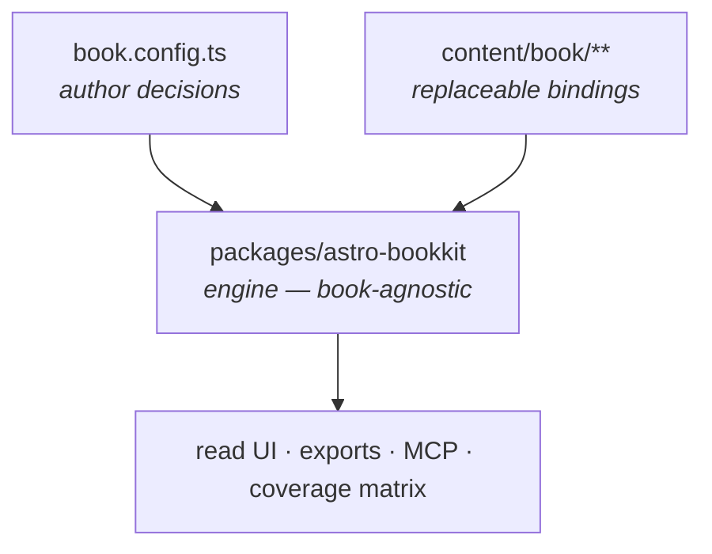
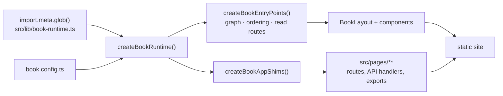
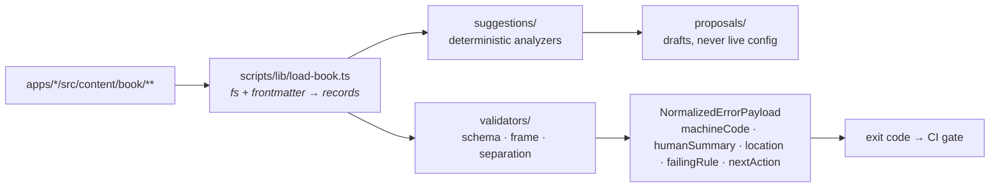

# Architecture

Canonical description of how this workspace is put together: what the parts are, which direction they depend on each other, and where a given change belongs.

- [`AGENTS.md`](../AGENTS.md) is the **law** — the invariants you may not break.
- [`docs/design-notes.md`](./design-notes.md) is the **case law** — why each invariant exists.
- This document is the **map** — what actually exists and how it fits.

Verified by `bun run check:architecture`, which fails CI when this document and the tree disagree. The machine-checked regions are marked in the source; edit them alongside the code they describe.

---

## The one-paragraph version

Bookkit compiles a book the way a toolchain compiles a program. An author declares intent in `book.config.ts`; content binds to that intent as structured MDX; a shared engine validates the result against a frame, derives a reading graph from declared prerequisites, and emits artifacts — a read UI, exports, an MCP endpoint, and for runbook books a coverage matrix. Books never fork the engine, and the engine never learns a book's name.

---

## Three layers, one rule

The layering is the load-bearing decision in the repo. Everything else follows from it.

| Layer | Lives in | Changes | Owned by |
| --- | --- | --- | --- |
| **Author decisions** | `apps/<book>/src/book.config.ts` | rarely; each change is a deliberate act | the author |
| **Engine / compiler** | `packages/astro-bookkit/**` | when a capability is needed by *any* book | engine contributors |
| **Content bindings** | `apps/<book>/src/content/book/**` | continuously | writers |

**The rule:** behavior flows down, never up. The engine knows nothing about a specific book. A book expresses variation through config or through an engine capability — never through book-specific logic in content files, and never by forking the engine.

`bun run check:separation` enforces the bottom of this: content bindings are data-only, no imports, no `<script>`, no `<style>`.



---

## Two pipelines

The same content tree is read by two independent pipelines. They share record shapes but not code paths, and confusing them is the most common way to put a change in the wrong place.

### Render pipeline — Astro, at dev/build time

Content reaches the engine through Vite's `import.meta.glob()`, which must be called from a file inside the app. That single constraint is why book apps have any local code at all.



`OUT` is a plain `dist/` directory. `bun run check:build` verifies it is deployable and `bun run bookkit deploy` publishes it as Cloudflare Workers static assets (see README → Deploy). Anything that needs a request handler at runtime — preview tokens, feedback and analytics collection, Q&A synthesis, MCP JSON-RPC — is inert on that static host; the middleware and the client code both degrade rather than break.

### Governance pipeline — Bun CLI, at check time

Nothing here touches Astro. Scripts read the content tree from disk, parse frontmatter into records, and run validators and analyzers over them.



The MCP endpoint is a third surface over the *same* governance pipeline: `mcp/` wraps the validators and the workspace reader behind JSON-RPC so an agent gets the identical answers the CLI gives.

**Where a change goes:** rendering, routing, or reader UI → render pipeline. Rules, checks, suggestions, or anything CI should fail on → governance pipeline. A new *record field* usually touches both — the schema (`schemas/`) and the CLI record parser (`scripts/lib/load-book.ts`).

---

## Workspace layout

<!-- architecture:workspace:start -->

| Path | Contains |
| --- | --- |
| `apps/` | one directory per book — config, content bindings, routes, thin runtime wiring |
| `packages/astro-bookkit` | the engine: schemas, frames, validators, graph, analyzers, MCP, exports, UI |
| `packages/create-bookkit` | standalone project generator; vendors the engine so output needs no registry |
| `scripts/` | CLI entrypoints — governance gates, scaffolds, compile/export tasks |
| `tests/` | workspace-level suites; module tests live beside their source as `*.test.ts` |
| `docs/` | this document, design notes, authorship model, bets, debt register |
| `.github/workflows/` | CI quality gate |

<!-- architecture:workspace:end -->

`bun run list:books` is the source of truth for which books are active.

### What stays app-local, and why

Book apps are deliberately thin. Three things cannot move into the engine:

- `src/lib/book-runtime.ts` — Vite resolves `import.meta.glob()` relative to the calling file.
- `src/pages/**` — Astro discovers routes by filename.
- the MCP route's `import.meta.url` hand-off.

Everything else is a re-export. Canonical wrapper contents live in `packages/astro-bookkit/templates/book-app/**` and are held identical across books by `bun run check:shims` (`bun run sync:shims` to update them).

---

## Content sections

Every book binds content into the same fixed sections. Adding a section is an engine change, not a book change.

<!-- architecture:content:start -->

| Section | Holds | Identity |
| --- | --- | --- |
| `chapters/` | prose; the overview chapter carries the frame's required headings | file order + prerequisites |
| `mechanisms/` | named, bounded concepts with `is` / `isNot` and testable predictions | **stable slug** — redefinition is breaking |
| `toolkit/` | action primitives: ≤10 minutes, executable, failure-resilient | stable slug |
| `examples/` | illustrations of a mechanism in a concrete domain | replaceable by design |
| `glossary/` | terms registered so they are not floating concepts | term |
| `releases/` | dated release narratives, joined against HEAD coverage | date |

<!-- architecture:content:end -->

---

## Engine module map

Tiers are enforced: **a module may only import from a strictly lower tier.** Same-tier imports are legal only between modules inside a declared cycle. `check:architecture` computes the real import graph — value imports only, since type-only edges vanish at build time — and fails on any violation.

<!-- architecture:modules:start -->

| Module | Tier | Owns |
| --- | --- | --- |
| `utils/` | 0 | small shared helpers with no engine dependencies, including the one frontmatter parser |
| `schemas/` | 0 | Zod frontmatter schemas — the record contract for every content section |
| `styles/` | 0 | `bookkit.css`, the shipped stylesheet |
| `llm-local/` | 0 | in-browser model adapter (optional dependency) |
| `embeddings/` | 0 | embedding generation for semantic search |
| `qa/` | 0 | AI question-answering providers behind the reader Q&A feature |
| `rerank/` | 0 | result reranking for search |
| `markdown/` | 1 | heading extraction and slugging; the rehype plugin apps register |
| `analytics/` | 1 | reader analytics events and the append-only log |
| `feedback/` | 1 | reader feedback capture |
| `preview/` | 1 | preview links and their access state |
| `releases/` | 1 | release notes, versions, RSS, email, webhooks |
| `exports/` | 1 | PDF and EPUB generation |
| `localization/` | 1 | locale resolution and translation notices |
| `suggestions/` | 1 | deterministic analyzers — overlap (per book and across a corpus of books), concept triage, example audit, prerequisites, runbook coverage |
| `frames/` | 1 | frame registry and the built-in frames (intervention, field-guide, runbook) |
| `validators/` | 1 | book, frame, and separation validation; content contracts, the per-file checker, and scaffolds built from them; the `NormalizedErrorPayload` shape |
| `search/` | 2 | search index construction and querying |
| `seo/` | 2 | sitemap, metadata, indexability rules, link-preview images |
| `mcp/` | 2 | JSON-RPC router, workspace reader, and deterministic tool handlers |
| `proposals/` | 2 | turns analyzer output into reviewable drafts; frame detection; guarded materialization |
| `app-wrappers/` | 3 | route-handler factories the book apps re-export as API endpoints |
| `book/` | 4 | runtime assembly, entrypoints, reading graph, ordering, read routes, layout state |
| `components/` | 4 | shared Astro components and page-level compositions |
| `layouts/` | 4 | `BookLayout` and the reader shell islands |

<!-- architecture:modules:end -->

### Declared import cycles

Two cycles exist and are tolerated. They are listed here so the gate can hold the line at *these two* and fail any new one.

<!-- architecture:cycles:start -->

- `frames` ↔ `validators` — the registry validates frame definitions on registration, while validation reads the default frames. Both halves are small and stable; splitting them would add an indirection layer for one function.
- `book` ↔ `components` ↔ `layouts` — Astro's component model is mutually recursive by nature: a layout renders components, and page-level components render the layout. Breaking this would mean duplicating the shell.

<!-- architecture:cycles:end -->

Anything else is a violation. Fix it by moving shared code down a tier or inverting the dependency — not by adding a line here.

---

## Extension points

| You want to… | Change | Also update |
| --- | --- | --- |
| add a required section to a book type | `frames/defaults.ts` | validator error text; migration note in `CHANGELOG.md` |
| add a field to a content record | `schemas/<section>.ts` | `scripts/lib/load-book.ts` if any gate reads it |
| add a governance gate | new `scripts/check-*.ts` | `package.json`, CI workflow, `CONTRIBUTING.md` matrix |
| add an analyzer | `suggestions/` | `check:suggestions` output; `proposals/` if it should produce drafts |
| expose something to agents | `mcp/tool-handlers/` | `mcp/tool-definitions.ts` |
| add a reader surface | `components/` or `layouts/` | package `exports` map; shim templates if apps must wire it |
| add a book | `bun run new:book` | nothing in the engine |

A change that does not fit a row above is usually in the wrong layer. The intended alternatives are always: **a new engine capability, or explicit configuration at the book layer.**

---

## What the architecture forbids

These are the failure modes the gates exist to catch:

- **book-specific logic in the engine** — no `if (book === "on-call")`, ever
- **logic in content bindings** — caught by `check:separation`
- **forking the engine for one book** — caught in review; the fix is config or capability
- **redefining a mechanism slug** — a breaking change, not an edit
- **weakening a validator to make a build pass** — fix the record instead
- **a new import cycle** — caught by `check:architecture`

---

## Keeping this document true

This file is checked, not trusted:

```bash
bun run check:architecture
```

It verifies that the module map lists every engine module and only real ones, that every documented tier holds against the real import graph, that the declared cycles are exactly the cycles that exist, and that the workspace and content tables match the tree. It runs in CI alongside the other gates.

If you add, rename, remove, or re-layer a module, this document is part of that change.
